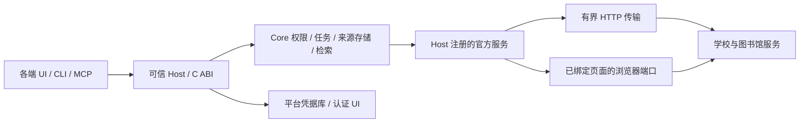

# 接入架构与契约

日期：2026-11-09。本文是实施设计，API 示例是拟议契约。

## 依赖边界



箭头表示运行时调用。共享 Core 只认识 CoreService/PlatformPort/通用传输，不编译依赖复旦协议、Flutter、MCP 或浏览器。官方连接器/插件拥有端点、页面字段、学校规则与状态映射；宿主将服务注册给 Core。UI 与 Agent 读取同一来源记录，业务缓存不分别重建。

## 传输选择

| 来源条件 | 采用方式 | 缺失时的行为 |
| --- | --- | --- |
| 已证实的公开 HTTP 数据 | Anonymous + 当前 BoundTransport | 返回网络/结构错误；不自动注入个人凭据 |
| 已明确允许原生 HTTP 的服务 Cookie/Bearer | HostSession/HostToken | 认证挑战，保留原访问模式；401 不自动切到其它身份 |
| 非标准 header/token | 宿主拥有的 CredentialRef 与官方认证提供者 | 尚无 provider 时明确不可用，不向插件返回秘密 |
| 需要已认证页面、WAF 或网页请求包装 | 有可信页面句柄的 BrowserSession 传输，或官方 JS 插件调用 browser.request | 缺少平台/页面绑定时 CapabilityUnavailable；不改用 Rust HTTP |
| Proto/非文本二进制 API | 通用 byte body/response 桥 + 连接器解码 | schema/字节传输未验证时 UnsupportedProtocol |

当前源码事实：

- `transport.rs:66` 的 ConnectorRequest/Response 具有字节体，但 Auth enum 的 BrowserSession 只有账号，没有实际页面句柄。
- `core_adapter.rs:102` 的 BoundTransport 当前拒绝 BrowserSession；`:130` 将请求 body 解析为 UTF-8 String，`:178` 将文本响应转回 bytes。
- `network.rs:738` 为 HostToken 注入 Bearer；它不是图书馆 access_token 自动提供者。
- `engine.rs:412` 的 http.policy.set 支持 Owner 的指定 HTTPS 私网来源。该权限不会因业务名称自动授予其它 principal。

因此 P0 可直接复用纯 HTTP 的接缝；P1 的页面绑定和新凭据提供者需显式实施；云盘二进制属于后续通用能力，而非本轮假定已有。

## 认证与账号核对

宿主维护服务会话目录，而不是一个校园登录布尔值：

```text
ServiceBinding {
  account_id, source_id, origin,
  transport_mode,
  opaque_credential_or_page_ref,
  subject_verified, role_verified?,
  expires_at?, binding_epoch
}
```

凭据/页面引用只能由可信宿主创建。业务参数不能指定 principal 或声称 subject_verified。会话加载成功、登录链返回 Cookie、服务私有读取及当前账号核对是不同状态。

优先使用服务自身的本人信息：eHall data/info、OPAC getReaderInfo 等需要先验证实际字段。现有 my 可见宿主依赖 Canvas profile 做账号核对；新的通用提供者不应强制所有服务依赖 Canvas 的可用性。身份字段只在宿主比对，普通报告输出核对结果或未知，不输出学号、姓名及邮箱。

MFA/扫码/密码更新由可见认证端口处理；当前原生固定 LoginTarget 不能自动变成任意站点认证器。新增每个服务时登记精确身份域、目标域、回调和当前本人检查，禁止通配所有校内域。验证码失败或明确凭据拒绝不自动重交密码。账号切换/退出撤销 binding_epoch，清理页面与会话，拒绝晚到结果。

## 数据与权限

继续使用 SourceContext/SourceRecord 封套：account_id/source_id/external_id/observed_at/updated_at/source revision。领域模型新增在官方连接器，例如 CatalogLesson、Syllabus、ServiceSummary、TaskSummary、Loan、AcademicProgress、EnergyUsage、ExerciseRecord。

- 公开开课/服务目录与私人任务/借阅分 source；公共可见性不意味着可执行权限。
- 字段缺失、角色不符、未开放、正常空列表、结构漂移分别处理；未知不能转换成零学分、零余额或已完成。
- 学校审批/成绩/毕业状态保留官方含义；本地 TODO 完成仅影响本地。
- 数字 ID 用可无损的字符串；钱用整数分，学分/kWh 保留精度与原单位，纯日期按学校 Asia/Shanghai 解释。
- 默认最小字段；任务签名外链、取件码、身份码、凭据和完整申请材料不进 FTS、MCP 或通用诊断。
- 公共服务链接经协议/域/用户信息检查；私人链接转为内部 ref，按当前权限向可信 UI 重新获取。

每个方法声明 source/domain/account/capability 约束。MCP 以原 principal 执行，不能自行登录、配置凭据、修改 grants 或借用 Owner 私网权限。插件缓存按账号与有效 grants 隔离，授权变化后不能读出先前更高权限缓存。

## 分页、刷新与恢复

统一保留 items、可选 total、查询/游标、观测时间及 coverage，来源特定页码只在连接器内部使用。对 eHall total=0/list 非空、OPAC pageNum/借阅 pageNo、Canvas Link 三类协议分别处理。

每次设 page/item/byte/time 预算；重复页/重复 ID、截断、来源总数变化、空中间页、任何后续页失败产生 partial。抓取和解析完成后才提交对应范围的来源快照；不把有界列表缺席当服务器删除。首轮同步抑制重复通知，周期同步复用现有 native service jobs、原 principal 与 lease/截止时间。

源/账号/查询条件/认证 binding_epoch 参与缓存和下载续传范围。HTTP200 登录壳或认证中断不覆盖既有缓存。备份恢复后按已有 Core 规则重设认证绑定与授权，再允许查询。

## 写入边界

本轮只研究写入方案，不执行远端业务写入。后续采用独立 preview/execute/reconcile 方法，而非任意表单代理：

1. 读取最新目标/资格/价格与表单版本，规范化账号、动作、目标、金额/币种、附件资产 hash 与有效期；输出可审阅摘要。
2. 可信 UI/宿主批准具体 preview hash，非 Owner 另有 execute 授权；输入 confirm=true 不构成权限。
3. 提交前重新核对权限与目标，持久化操作账本。来源没有幂等机制时，不假造服务器幂等保证。
4. 超时、断流、退出或崩溃保留 NeedsReconciliation，不自动重交；用服务器申请号/订单号或经验证的状态读取对账。
5. 无权取得权威结果时保持未知；取消插件/回滚/本地完成不能清除未知外部写入。

续借以借期/次数和书目为核对维度；充值建单与支付分开，余额变化不能单独证明某单成功；支付优先官方收银台；审批阅读权限不授予审批执行。播放心跳、签到、已读标记、收藏、申请与消息发送按实际语义分类，不依赖 HTTP 动词名称判断。

## 验收顺序

先合成 fixture 和 fake ConnectorTransport/PlatformPort，核验结构、分页、来源权限、页面上下文、撤权/账号切换和未知写入；再跑共享 Rust 连接器原生测试；再验证 Android 适配；最后进行用户本人只读服务验证。跨编译、模拟器、真人账户、真实写入分别记录。

原生匿名连接器不能代替浏览器认证验收。一个课程/一页/一个角色成功不能扩展成所有课程或所有学校服务均兼容。
