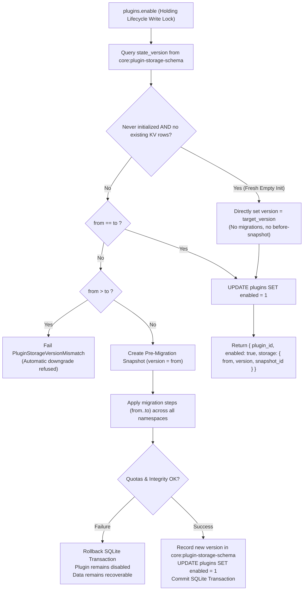

# Private Plugin Storage Migrations and Snapshot Recovery

This document specifies the declarative migration, transactional transition, and snapshot recovery system for private plugin key-value storage in `dansheng-core`.

Implementation references:
- Declarative schema & manifest validation: `crates/dansheng-core/src/plugins/storage_schema.rs`, `crates/dansheng-core/src/plugins/manifest.rs`
- Transactional migration, snapshots & restore: `crates/dansheng-core/src/plugin_storage.rs`
- Engine RPC dispatch and lifecycle write lock: `crates/dansheng-core/src/engine.rs`
- TypeScript declarations & host types: `sdk/index.d.ts`, `sdk/examples/plugin-storage.ts`

---

## 1. Scope and Isolation Boundary

This subsystem applies **strictly and exclusively** to private plugin key-value storage accessed via `ctx.storage` (`storage.get`, `storage.set`, `storage.delete`).

It does **not** govern or apply to:
- **Canonical sources** (`ctx.sources`, `sources.upsert`, `sources.query`) — canonical records live in the core record store with their own source namespaces.
- **Organizer entities** (`ctx.todo`, `ctx.calendar`, `ctx.reminders`, `ctx.activity`) — unified personal items managed by core schemas.
- **Managed assets** (`ctx.files`, `files.download`, `files.read`, `files.list`) — stored in the asset manager with filesystem storage and dedicated indexers.
- **Platform vault** (`vault.get`, `vault.set`, `vault.delete`) — secrets and credentials mediated exclusively through platform security providers.

> [!CAUTION]
> Never store credentials, passwords, session tokens, or bearer headers in `ctx.storage`. Secrets belong exclusively in the platform vault. `ctx.storage` is reserved for non-sensitive plugin-internal state such as synchronization cursors and user preferences.

All operations described herein are local-first, offline SQLite transactions. They do not trigger remote campus requests or mutate remote service state.

---

## 2. Per-Grant / Per-Account Namespace Preservation

### Storage Namespaces
Private storage keys are stored in the SQLite `kv` table partitioned by a namespace prefix:
```
plugin-state:<plugin_id>:<fingerprint>
```
where `<fingerprint>` is a 64-character lowercase hex digest (SHA-256) derived from the grant configuration under which the plugin was executed:
```json
{
  "accounts": grant.account_ids,
  "capabilities": grant.capabilities,
  "origins": grant.origins,
  "private_network": grant.allow_private_network,
  "sources": grant.source_ids,
  "organizer_scope": grant.organizer_scope
}
```

This ensures that different accounts and different permission grants maintain strictly isolated private KV spaces.

### Preservation During Migration and Snapshots
- When migrations run on plugin enablement, core scans for all distinct namespaces matching prefix `plugin-state:<plugin_id>:`.
- Every grant namespace is migrated **independently**. Keys from distinct grants or accounts are **never merged or co-mingled**.
- When a recovery snapshot is generated, each namespace is cloned into:
  ```
  plugin-storage-snapshot:<plugin_id>:<snapshot_id>:<fingerprint>
  ```
  The complete 64-character namespace suffix `<fingerprint>` is preserved verbatim.
- On snapshot restore, data is copied back to `plugin-state:<plugin_id>:<fingerprint>`, preserving the exact partitioning.

---

## 3. Schema Declaration in Plugin Manifest

Plugins declare their private storage version and migration roadmap in `manifest.json` under the optional `storage_schema` field:

```json
{
  "id": "example.notes-sync",
  "version": "0.2.0",
  "api_version": 1,
  "entry": "main.mjs",
  "name": "Example notes sync",
  "capabilities": ["storage.read", "storage.write"],
  "network": ["https://example.com"],
  "actions": {
    "sync": {
      "description": "Synchronize notes",
      "mutating": false
    }
  },
  "storage_schema": {
    "version": 2,
    "migrations": [
      {
        "from": 0,
        "to": 1,
        "operations": [
          { "op": "rename_key", "from": "legacy_cursor", "to": "sync_cursor" },
          { "op": "set_default", "key": "preferences", "value": { "auto_sync": true } }
        ]
      },
      {
        "from": 1,
        "to": 2,
        "operations": [
          {
            "op": "patch_object",
            "key": "preferences",
            "rename_fields": { "auto_sync": "enabled" },
            "defaults": { "notify_on_update": true },
            "remove_fields": ["legacy_flag"]
          },
          { "op": "delete_key", "key": "obsolete_cache" }
        ]
      }
    ]
  }
}
```

### Manifest Schema Rules
1. **Target Version**: `version` is an integer where `1 <= version <= 1,000,000`. Omitting `storage_schema` implies target version `0`.
2. **Step Progression**: Each migration step must increment the version by strictly `+1`:
   $$\text{step.from} + 1 = \text{step.to}$$
3. **Sorted Order**: Steps must be sorted in strictly ascending order without overlapping or jumping backwards (`step.from < step.to <= target_version`).
4. **Limits**:
   - At most 128 migration steps per schema.
   - At most 256 total operations across all migration steps combined.

---

## 4. Supported Migration Operations

Each operation within a migration step is a tagged JSON object (`op: "<operation_name>"`), mapped directly to the Rust enum `PluginStorageOperation`:

### 1. `rename_key`
Renames a key within each grant namespace:
```json
{ "op": "rename_key", "from": "old_key", "to": "new_key" }
```
- Keys must be 1..256 bytes and must not contain characters rejected by Rust's `char::is_control`.
- `from != to`.
- If `from` exists and `to` already exists in the same namespace, the transaction fails with `PluginStorageConflict`.
- If `from` does not exist, the operation is a no-op.

### 2. `delete_key`
Deletes a key from each grant namespace:
```json
{ "op": "delete_key", "key": "temporary_data" }
```
- Key must be 1..256 bytes without any Unicode control characters.
- Idempotent: does nothing if the key does not exist.

### 3. `set_default`
Inserts a key-value pair only if the key is not currently present:
```json
{ "op": "set_default", "key": "settings", "value": { "theme": "system", "retries": 3 } }
```
- Uses SQLite `INSERT INTO kv VALUES(?,?,?) ON CONFLICT(namespace, key) DO NOTHING`.
- Existing keys and values remain unchanged.
- **Important**: Fresh empty installations and newly authorized grant scopes do not execute historical migration defaults. The plugin action must initialize required defaults in normal application code when keys are missing.

### 4. `patch_object`
Selectively patches properties within a stored JSON object value:
```json
{
  "op": "patch_object",
  "key": "settings",
  "rename_fields": { "old_name": "new_name" },
  "defaults": { "notifications": true },
  "remove_fields": ["deprecated_counter"]
}
```
- Key and property names must be 1..256 bytes without any Unicode control characters.
- If the key exists, its value is parsed as JSON. If the value is not a JSON object, the migration fails with `PluginStorageTypeMismatch`.
- `rename_fields`: Renames field `old_name` to `new_name`. If `new_name` already exists on the object, fails with `PluginStorageConflict`.
- `remove_fields`: Removes specified field keys.
- `defaults`: Injects key-value pairs if the field key is absent.
- Bounded: Total field operations (`rename_fields.len() + defaults.len() + remove_fields.len()`) must be between 1 and 128.
- Serialized patched value must not exceed 1 MiB (`1024 * 1024` bytes).

---

## 5. Migration Execution and Lifecycle

Plugin storage transitions occur during `plugins.enable` under Engine's exclusive `plugin_lifecycle.write()` lock.



### Version 0 Legacy State
If a plugin has existing data under `plugin-state:<plugin_id>:*` but has no version entry recorded in `core:plugin-storage-schema`, its initial version is treated as `0`. Declaring migrations starting from `from: 0` will seamlessly upgrade this unversioned legacy state.

### Fresh Empty Initialization and New Grant Scopes
1. **Fresh Empty Installation**: When a plugin is enabled for the first time without any pre-existing version record or storage keys (`version.is_none() && names.is_empty()`), core records the declared target version directly into `core:plugin-storage-schema`. It does **not** execute historical migration steps or create an empty before-snapshot.
2. **New Grant Scopes**: When an already-migrated plugin is subsequently run under a fresh account or grant, a new namespace is initialized empty at runtime. Historical migration operations (including `set_default` and `patch_object`) are **not** retroactively evaluated on new scopes. Plugin action code is responsible for checking key presence and populating runtime defaults.

### Atomicity and Failure Guarantees
- The pre-migration snapshot, all migration steps across all grant namespaces, the version record update, and plugin enablement execute within a **single SQLite transaction**.
- If any step encounters an error (`PluginStorageConflict`, `PluginStorageTypeMismatch`, `PluginStorageQuotaExceeded`, or `PluginStorageMigrationMissing`), the transaction is rolled back immediately.
- The plugin remains **disabled** (`enabled = 0`).
- Previous data and state version remain completely intact and uncorrupted.
- The error message returned is:
  `"private plugin storage transition refused; data remains recoverable"`

---

## 6. Snapshot Bounds and Quotas

Core distinguishes between limits enforced during **migration/snapshot procedures** and quotas on **normal runtime writes**:

### Migration and Snapshot Bounds
During `plugin_storage_enable`, snapshot creation, and snapshot restoration, the following cumulative bounds are verified:

| Parameter | Limit | Enforcement / Error |
| :--- | :--- | :--- |
| **Max Snapshots per Plugin** | `8` | `PluginStorageSnapshotLimit` |
| **Max Total Bytes per Plugin** | `64 MiB` (`67,108,864` bytes) across all scopes | `PluginStorageQuotaExceeded` |
| **Max Total Entries per Plugin** | `65,536` KV rows across all scopes | `PluginStorageQuotaExceeded` |
| **Max Scopes (Namespaces)** | `1,024` namespaces per plugin prefix | `PluginStorageScopeInvalid` |
| **Max Bytes per Namespace** | `16 MiB` during migration | `PluginStorageQuotaExceeded` |
| **Max Value Size** | `1 MiB` (`1,048,576` bytes) per row | `PluginStorageQuotaExceeded` |
| **Max Key Length** | `256` bytes (no Unicode control chars) | Validation failure |
| **Snapshot ID Format** | UUIDv4 string | Validation failure |

### Normal Runtime Write Quota
The 64 MiB, 65,536-row, and 1,024-scope bounds are migration and snapshot boundaries, **not** a global check on every individual `ctx.storage.set` call. Normal runtime storage is bounded by the existing `kv_set` quota of **16 MiB per namespace**.

### Snapshot Integrity
Snapshots calculate a SHA-256 digest over all sorted `(namespace_suffix, key, data)` tuples. When restoring, core verifies that entry count, byte size, scope count, and SHA-256 digest match the snapshot metadata exactly; any discrepancy fails with `PluginStorageSnapshotCorrupt`.

---

## 7. Rollback and Recovery Recipe

Core **strictly refuses automatic downgrades**: if `from > to`, plugin enablement fails with `PluginStorageVersionMismatch`. 

To roll back a plugin to an older version and recover its matching private storage:

```mermaid
sequenceDiagram
    autonumber
    actor Operator as Trusted Host / Operator
    participant Core as Engine RPC
    participant DB as SQLite Profile DB

    Operator->>Core: plugins.rollback { plugin_id, generation }
    Note over Core,DB: Stops active runs, rolls back package files, sets enabled = 0
    Core-->>Operator: { plugin_id, version, enabled: false }

    Operator->>Core: plugins.storage.snapshots { plugin_id }
    Note over Core: Owner-only read; does NOT take lifecycle write lock
    Core-->>Operator: { version: current_v, snapshots: [...] }

    Note over Operator: Inspect snapshots; select explicit snapshot_id<br/>Verify selected_snapshot.version == target_manifest_version

    Operator->>Core: plugins.storage.restore { plugin_id, snapshot_id }
    Note over Core,DB: Holds lifecycle write lock.<br/>1. Verify plugin is disabled<br/>2. Verify snapshot.version == manifest.target_version<br/>3. Verify SHA-256 & byte/entry/scope bounds<br/>4. Take REVERSE recovery snapshot of current state<br/>5. Overwrite plugin-state with snapshot data<br/>6. Set version = snapshot.version<br/>7. Keep enabled = false
    Core-->>Operator: { plugin_id, version, restored: true, enabled: false, recovery_snapshot_id }

    Operator->>Core: plugins.enable { plugin_id }
    Note over Core,DB: Validates version matches; sets enabled = 1
    Core-->>Operator: { plugin_id, enabled: true, storage: { from, version, snapshot_id: null } }
```

### Key Recovery Guarantees
1. **Explicit Target Snapshot Selection**: The operator provides the exact `snapshot_id` to restore. Because multiple snapshots may share the same declared version (e.g. from prior migrations, restores, or iterations), locating by version alone is ambiguous. The host verifies that the chosen snapshot matches the target version.
2. **Reverse Recovery Snapshot**: Restoring a snapshot automatically generates a reverse recovery snapshot of the data being overwritten before committing. If an operator mistakenly restores an older snapshot, the forward state is not destroyed and can be recovered.
3. **Post-Restore Disabled State**: A restored plugin always remains disabled (`enabled: false`). The operator must explicitly call `plugins.enable` after inspecting the outcome.
4. **Snapshot Discard**: Obsolete snapshots can be deleted by the operator using `plugins.storage.discard { plugin_id, snapshot_id }`.

---

## 8. Host-Only RPC vs Plugin Runtime Facade

There is a strict privilege separation between trusted host administrative RPCs and the QuickJS in-sandbox plugin facade:

| RPC / Facade Method | Caller Privilege | Lifecycle Lock | Accessible via `ctx`? | Purpose |
| :--- | :--- | :---: | :---: | :--- |
| `ctx.storage.get` | Plugin Action | None | **Yes** | Read a private key in the current grant namespace |
| `ctx.storage.set` | Plugin Action | None | **Yes** | Write a private key in the current grant namespace |
| `ctx.storage.delete` | Plugin Action | None | **Yes** | Delete a private key in the current grant namespace |
| `plugins.storage.snapshots` | Trusted Host / Owner | None (Read-only) | **No** | List available storage snapshots and metadata |
| `plugins.storage.restore` | Trusted Host / Owner | `plugin_lifecycle.write()` | **No** | Restore storage to an explicit snapshot |
| `plugins.storage.discard` | Trusted Host / Owner | `plugin_lifecycle.write()` | **No** | Delete an obsolete storage snapshot |

> [!IMPORTANT]
> `plugins.storage.snapshots` is an owner-only read method that does not take the lifecycle write lock. `plugins.storage.restore` and `plugins.storage.discard` take the exclusive `plugin_lifecycle.write()` lock. None of these administrative methods are accessible to untrusted JavaScript plugin code.

---

## 9. Interaction with Profile Backup and Restore

- **Backup Creation (`backup::create`)**:
  Captures all `kv` table rows including `plugin-state:*`, `plugin-storage-snapshot:*`, and `core:plugin-storage-schema`. All private plugin data and historical recovery snapshots are preserved.
- **Offline Profile Restore (`backup::restore`)**:
  Restores the database and all files, performing an explicit **authority reset**:
  ```sql
  DELETE FROM clients;
  DELETE FROM grants;
  DELETE FROM kv WHERE namespace IN (
    'core:session-policy',
    'core:network-routes',
    'core:credential-bindings',
    'core:plugins',
    'core:catalogs'
  );
  UPDATE plugins SET enabled = 0;
  ```
  - **Data Preserved**: Storage data rows (`plugin-state:*`), recovery snapshots, and schema version records (`core:plugin-storage-schema`) are **fully preserved**.
  - **Authority Reset**: All plugins are disabled (`enabled = 0`), and client authentication tokens and grants are cleared.
  - **Target Publisher Trust Preserved**: The **current target profile's** complete `core:plugins` KV namespace (trusted publisher public keys, immutable key-ID history, and catalog sequence floors) is restored into the stage. Restoring an imported backup clears imported authority without destroying the host's pre-existing target publisher trust policy.
  - Re-enabling a restored plugin through `plugins.enable` performs the standard schema version verification before activating.
