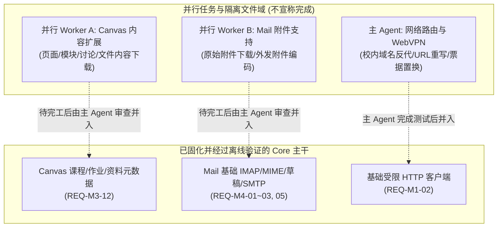
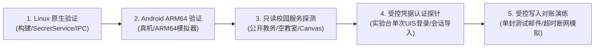

# dansheng-core 需求落地与验证状态审计核对单 (Requirements & Evidence Audit Matrix)

> **审计基准与声明**  
> - **审计日期**：2026-11-06  
> - **审计工作区**：`C:/Code/dansheng`  
> - **审计目标文件**：`docs/requirements-audit.md`（只读核对与唯一写入文档）  
> - **审计性质**：只读代码与历史文档核对。**本审计未执行实时构建、未发起真实网络请求、未执行测试套件、未读取任何平台 Vault 或个人凭据**。文档中引用的测试通过数量与覆盖记录均严格标记为历史证据来源及日期，不作为当前代码的实时通过宣称。  
> - **验收结论约束**：**主 Agent 会逐项审核这份清单；本审计总结不构成验收结论。**  
> - **隐私与合规保证**：本文档严格禁止且不包含任何真实学号、身份标识、Token、Cookie、姓名、密码、余额或个人流水记录。所有真实凭据验证均由主 Agent 通过本机受控服务按规范实施。  
> - **在建任务隔离说明**：当前并行 Worker 正在实现的「Canvas 内容扩展」与「Mail 附件处理」，以及主 Agent 正在实现的「网络路由 / WebVPN」，均属于未完工阶段，本文档严格不作任何成功或完成宣称。

---

## 验证层级与状态矩阵标记说明

为了严格落实 `AGENTS.md` 与 `docs/roadmap.md` 中的证据分级政策，杜绝将代码存在或合成测试混淆为真实平台及真实服务通过，本文对每个需求项使用 8 个独立的验证状态维度进行标记：

| 维度标识 | 验证层级定义 | 判定准则 |
| :--- | :--- | :--- |
| **`[代]`** | **代码存在 (Code exists)** | 对应数据结构、函数接口或模块实现已落地到代码仓库中。 |
| **`[离]`** | **离线 fixture / 单元测试通过** | 在断网离线环境下，使用合成数据、Mock 桩或回环测试验证通过。 |
| **`[Win]`** | **Windows 原生执行通过** | 在 Windows x86_64 原生环境（如 Windows GNU 工具链）下成功编译或执行。 |
| **`[And]`** | **Android 模拟器执行通过** | 在专用 Android 模拟器（如 API 36 x86_64）中完成 instrumentation 测试。 |
| **`[ARM]`** | **ARM64 交叉编译通过** | 使用 Android NDK 完成 AArch64 目标产物的跨平台静态/动态库编译。 |
| **`[Lin]`** | **Linux 原生执行通过** | 在 Linux 环境下完成真实二进制构建、Secret Service 接入及 Unix 域套接字通信。 |
| **`[校]`** | **真实学校服务通过** | 真实访问复旦大学相关服务端口并获取真实有效响应（非合成数据）。 |
| **`[写]`** | **真实远程写入通过** | 真实向远程服务器提交预约、变更、邮件发送或支付扣款等有副作用的写入操作。 |

> 状态标记符号：`●` 表示有明确历史证据记录；`○` 表示未实施或缺少直接证据；`◐` 表示部分覆盖或存在已知限制；`—` 表示不适用该维度。

---

## M0: 基线、工具链与集成契约 (Baseline, Toolchain & Contracts)

### 原始 Roadmap 范围与验收门槛
- **范围**：固化公开 DanXi/Dela 及选定的本地 sports 快照，源码归属与开源协议声明，工作区/工具链/CI/集成契约。
- **必需证据**：实际编译 Rust 核心库，在 Windows/Linux/Android 上加载 SQLite 与 QuickJS；严格区分「已编译」与「已执行」。

### M0 详细核对表

| 门槛 ID | 原 Roadmap 明确要求 | 当前代码落点 | 验证状态矩阵 | 历史证据来源及日期 | 缺少证据 / 未实现部分 | 所需下一步验收 |
| :--- | :--- | :--- | :---: | :--- | :--- | :--- |
| **REQ-M0-01** | 固化公开 DanXi/Dela 及本地 sports 快照 | `reference/manifest.json` | `[代] ●` `[离] ●` `[Win] —` `[And] —` `[ARM] —` `[Lin] —` `[校] —` `[写] —` | `reference/manifest.json` `docs/validation.md` (2026-11-06) | 无代码缺失。DanXi (`3c1f5f0`)、Dela (`e82da12`)、DanXi-local-sports (`f6a4532`) 均已锁定 SHA。 | 上游如有更新需主 Agent 审查并重新计算清单哈希。 |
| **REQ-M0-02** | 开源协议归属与 NOTICE 声明 (GPL-3.0-or-later) | `LICENSE` `Cargo.toml` `crates/dansheng-connectors/NOTICE.md` `plugins/fudan-sports/NOTICE.md` | `[代] ●` `[离] —` `[Win] —` `[And] —` `[ARM] —` `[Lin] —` `[校] —` `[写] —` | `dist/dansheng-core-0.1.0/THIRD-PARTY-NOTICES.txt` `docs/validation.md` (2026-11-06) | 无代码缺失。所有官方连接器、示例及插件均附带来源说明与 SPDX 头。 | 发布打包时自动化检查许可声明完整性。 |
| **REQ-M0-03** | 统一工作区工具链与依赖锁定 | `rust-toolchain.toml` (1.99.1) `Cargo.toml` `Cargo.lock` `.github/workflows/ci.yml` | `[代] ●` `[离] ●` `[Win] ●` `[And] —` `[ARM] —` `[Lin] ○` `[校] —` `[写] —` | `docs/validation.md` (2026-11-06) (记录 Windows GNU 下 213 项 Rust 测试通过；clippy/fmt 通过) | 本机未触发 GitHub Actions 远程 CI 运行；缺少 Linux CI 实际成功执行日志。 | 在真实 Linux Runner 上触发 `.github/workflows/ci.yml` 并留存日志。 |
| **REQ-M0-04** | 跨语言 C ABI 与集成契约规范 | `include/dansheng.h` `docs/implementation-contract.md` `crates/dansheng-ffi/src/lib.rs` | `[代] ●` `[离] ●` `[Win] ●` `[And] ●` `[ARM] ●` `[Lin] ○` `[校] —` `[写] —` | `docs/android-sports.md` (2026-11-06) `docs/validation.md` (2026-11-06) (记录 JNI/ABI 在模拟器中往返测试通过) | 未在 Linux 原生 C 测试程序中链接 `libdansheng_ffi.so` 执行调用。 | 编写 Linux 本地 C 冒烟程序链接 ABI 动态库进行验证。 |
| **REQ-M0-05** | Windows 平台核心库构建、SQLite 与 QuickJS 引擎加载 | `crates/dansheng-core/Cargo.toml` `crates/dansheng-host/src/main.rs` | `[代] ●` `[离] ●` `[Win] ●` `[And] —` `[ARM] —` `[Lin] —` `[校] —` `[写] —` | `docs/validation.md` (2026-11-06) (记录 Windows release 二进制生成及本地冒烟测试通过) | 无缺失。已包含 bundled rusqlite 与 rquickjs。 | 持续集成构建中的二进制回归检查。 |
| **REQ-M0-06** | Android 平台核心库构建、SQLite 与 QuickJS 加载 (严格区分编译与执行) | `crates/dansheng-core/Cargo.toml` (`android` rquickjs bindgen) `platform/android/adapter/` | `[代] ●` `[离] ●` `[Win] —` `[And] ●` `[ARM] ●` `[Lin] —` `[校] —` `[写] —` | `docs/validation.md` (2026-11-06) (记录 x86_64 模拟器 25 项测试通过；ARM64 完成交叉编译) | **ARM64 SO 仅完成交叉编译，未在真实 ARM64 硬件或 ARM64 模拟器上实际执行**。 | 在真实 ARM64 Android 真机或 ARM64 系统映像中加载 SO 并执行冒烟。 |
| **REQ-M0-07** | Linux 平台核心库构建、SQLite 与 QuickJS 加载 | `crates/dansheng-core` `crates/dansheng-host/Cargo.toml` (`keyring` 依赖) | `[代] ●` `[离] ○` `[Win] —` `[And] —` `[ARM] —` `[Lin] ○` `[校] —` `[写] —` | `docs/validation.md` (2026-11-06) (明确记录：**Linux 本机没有执行构建、Secret Service 或 Unix socket 验证**) | **完全缺少 Linux 本机编译与运行证据**。 | 在 Ubuntu/Debian 环境下执行 `cargo test` 及 `dansheng-host` 启动冒烟。 |

### M0 复核 Checklist
- [x] `REQ-M0-01` 公开与本地参考仓库已在 `reference/manifest.json` 中固化并标注只读。
- [x] `REQ-M0-02` 源码协议（GPL-3.0-or-later）与第三方归属声明文件完整。
- [x] `REQ-M0-03` 工具链版本锁定（Rust 1.99.1 / MSRV 1.98），Windows 检查通过。
- [x] `REQ-M0-04` C ABI 头文件（`include/dansheng.h`）与异步操作契约定义明确。
- [x] `REQ-M0-05` Windows 环境下 SQLite 与 QuickJS 引擎集成通过。
- [ ] `REQ-M0-06` Android ARM64 仅交叉编译，**尚需 ARM64 硬件执行验收**。
- [ ] `REQ-M0-07` Linux 环境构建与执行**完全缺少验证证据，需在 Linux 环境验收**。

---

## M1 / 0.1: 本地核心回路、权限与 MCP (Core Loop, Plugins & MCP)

### 原始 Roadmap 范围与验收门槛
- **范围**：账号与会话代理、HTTP 传输、持久化数据与任务、权限 Grants、JS 插件安装与执行、声明式 UI 描述、本地 IPC / FFI / MCP。
- **必需证据**：同一 JS 软件包在桌面端与 Android 端运行；登录/数据/保存/查询/UI描述/MCP 闭环；负向权限拒绝、任务取消与进程重启恢复用例。

### M1 详细核对表

| 门槛 ID | 原 Roadmap 明确要求 | 当前代码落点 | 验证状态矩阵 | 历史证据来源及日期 | 缺少证据 / 未实现部分 | 所需下一步验收 |
| :--- | :--- | :--- | :---: | :--- | :--- | :--- |
| **REQ-M1-01** | 账号与会话代理 (平台 Vault 凭据隔离) | `crates/dansheng-core/src/api.rs` `crates/dansheng-host/src/security.rs` `platform/android/.../KeystoreVault.kt` | `[代] ●` `[离] ●` `[Win] ●` `[And] ●` `[ARM] —` `[Lin] ○` `[校] ○` `[写] —` | `docs/validation.md` (2026-11-06) (Windows DPAPI 会话恢复测试；Android Keystore 3 项测试通过) | Linux Secret Service 密钥环未实测；缺少真实学校账号登录会话注入测试。 | 验证 Linux Keyring 适配；主 Agent 注入受控凭据检验会话提取。 |
| **REQ-M1-02** | 受限 HTTP 客户端与会话 Cookie 管理 | `crates/dansheng-core/src/network.rs` (`HttpRequest`, `SessionJar`) | `[代] ●` `[离] ●` `[Win] ●` `[And] ●` `[ARM] —` `[Lin] ○` `[校] ◐` `[写] —` | `docs/validation.md` (2026-11-06) (release EXE 读取 14 条公开通知首页验证了基础 HTTP) | 网络路由/WebVPN 正在开发中；当前 `network.rs` 为基础直连，不支持校内专用反代重写。 | 待主 Agent 完成 WebVPN 路由后，验证受限校内站点的 HTTP 访问。 |
| **REQ-M1-03** | 持久化存储、任务队列与不确定写入对账 | `crates/dansheng-core/src/store.rs` `crates/dansheng-core/src/engine.rs` (`tick`, `NeedsReconciliation`) | `[代] ●` `[离] ●` `[Win] ●` `[And] ●` `[ARM] —` `[Lin] ○` `[校] —` `[写] ○` | `docs/validation.md` (2026-11-06) (离线任务取消、超时保留 `NeedsReconciliation` 测试) | 未发生真实远程写入故障，缺少在真实不稳定网络下的自动挂起与对账测试。 | 构造受控超时服务器模拟写入中断，验证重启后状态机不重复提交。 |
| **REQ-M1-04** | 细粒度权限 Grants 与负向权限拒绝用例 | `crates/dansheng-core/src/policy.rs` (`Principal`, `Grant`, `enforce_policy`) | `[代] ●` `[离] ●` `[Win] ●` `[And] ●` `[ARM] —` `[Lin] ○` `[校] —` `[写] —` | `docs/validation.md` (2026-11-06) (宿主 smoke 验证 MCP 拒绝自行授权及跨账号越权) | 生产 UI 交互式授权弹窗不在 Core 范围，由后续前端宿主提供。 | 补充跨插件私有数据访问的负向测试矩阵。 |
| **REQ-M1-05** | QuickJS 插件安装、原子暂存与内存/超时配额沙箱 | `crates/dansheng-core/src/plugins/` `plugins/examples/` | `[代] ●` `[离] ●` `[Win] ●` `[And] ●` `[ARM] —` `[Lin] ○` `[校] —` `[写] —` | `docs/validation.md` (2026-11-06) (36 项 JS 测试通过；堆 32MB / 栈 512KB / 30s 超时测试) | 插件升级时的热替换在运行中长连接场景的表现待进一步压力测试。 | 验证死循环 JS 脚本在达到 30s 超时后能被独立执行线程强行中止。 |
| **REQ-M1-06** | 跨平台同一 JS 插件包一致性验证 | `plugins/examples/` `sdk/check-runtime-facade.mjs` | `[代] ●` `[离] ●` `[Win] ●` `[And] ◐` `[ARM] —` `[Lin] ○` `[校] —` `[写] —` | `docs/validation.md` (2026-11-06) (SDK 50 方法 / 14 命名空间核对；Android 端运行了核心 native ABI) | 缺少在桌面端和 Android 端同时加载完全相同的 `.tar.gz` 预分发包并比对输出的比对用例。 | 编写跨平台一致性测试脚本，比对同一插件包在双端的输出 JSON。 |
| **REQ-M1-07** | 声明式 UI 描述与发布 (`ui.publish`) | `crates/dansheng-core/src/plugins/manifest.rs` `plugins/examples/http-monitor/main.mjs` | `[代] ●` `[离] ●` `[Win] ●` `[And] —` `[ARM] —` `[Lin] ○` `[校] —` `[写] —` | `crates/dansheng-connectors/VALIDATION.md` (2026-11-05) (QuickJS 状态监控 UI 发布测试) | 生产 UI 渲染器尚未实现（按设计规范生产 UI 属于独立项目）。 | 提供标准声明式 UI Schema 校验器供外部前端渲染层集成。 |
| **REQ-M1-08** | 本地 IPC (命名管道 / Unix Socket) 与 FFI 接口 | `crates/dansheng-host/src/frame.rs` `crates/dansheng-ffi/src/lib.rs` | `[代] ●` `[离] ●` `[Win] ●` `[And] ●` `[ARM] —` `[Lin] ○` `[校] —` `[写] —` | `docs/validation.md` (2026-11-06) (Windows 命名管道客户端认证与并发测试通过) | Linux Unix domain socket IPC 尚未执行过真实测试。 | 在 Linux 环境下运行 `smoke-host.mjs` 验证 socket 连通性。 |
| **REQ-M1-09** | Stdio MCP 适配器 (工具发现、调用与安全限制) | `crates/dansheng-host/src/mcp.rs` (`rmcp` 3.9) | `[代] ●` `[离] ●` `[Win] ●` `[And] —` `[ARM] —` `[Lin] ○` `[校] —` `[写] —` | `docs/validation.md` (2026-11-06) (stdio MCP 初始化、工具发现、读待办、拒绝越权测试通过) | 尚未接入外部生产级 MCP 客户端（如 Claude Desktop）进行长时间会话集成。 | 配置真实 MCP 客户端测试 stdio 双向通信与大报文处理。 |

### M1 复核 Checklist
- [x] `REQ-M1-01` 账号代理与平台凭据端口已在 Windows 和 Android 模拟器通过契约验证。
- [x] `REQ-M1-02` HTTP 会话隔离与请求参数约束具备代码与测试。
- [x] `REQ-M1-03` 任务持久化与 `NeedsReconciliation` 状态机已落地。
- [x] `REQ-M1-04` 权限交叉求交集（调用者 ∩ 插件）在 Rust 和 Host 层双重校验。
- [x] `REQ-M1-05` QuickJS 运行时沙箱配额在 Windows 与 Android JNI 上均有历史验证。
- [ ] `REQ-M1-06` 桌面与 Android 加载同源已编译插件包的自动化对比测试**尚需补充**。
- [x] `REQ-M1-07` 声明式 UI 发布接口与事件协议已定义。
- [ ] `REQ-M1-08` Linux Unix Domain Socket IPC **尚未实测**。
- [x] `REQ-M1-09` 本地 Stdio MCP 适配器与白名单策略已在 Windows release 验证。

---

## M2 / 0.2: Android 页面上下文浏览器端口与体育插件 (Android Browser Port & Sports)

### 原始 Roadmap 范围与验收门槛
- **范围**：Android 页面上下文浏览器端口、原生唤醒与前台生命周期、官方 `fudan-sports` 插件。
- **必需证据**：页面内 fetch/XHR 语义、交互式登录、账号切换、部分结果/取消/截止时间/对账处理；**严格禁止未经批准的真实预约**。

### M2 详细核对表

| 门槛 ID | 原 Roadmap 明确要求 | 当前代码落点 | 验证状态矩阵 | 历史证据来源及日期 | 缺少证据 / 未实现部分 | 所需下一步验收 |
| :--- | :--- | :--- | :---: | :--- | :--- | :--- |
| **REQ-M2-01** | Android 系统 WebView 页面上下文 fetch/XHR 传输端口 | `platform/android/adapter/.../WebViewBrowserPort.kt` `dansheng-page-transport.js` | `[代] ●` `[离] ●` `[Win] —` `[And] ●` `[ARM] —` `[Lin] —` `[校] ○` `[写] —` | `docs/android-sports.md` (2026-11-06) `docs/validation.md` (2026-11-06) (7 项浏览器模拟器测试通过) | **所有测试均使用合成 fixture.html 且网络被阻止；未在真实学校服务或学校 WAF 页面验证**。 | 在受控测试环境下加载真实 Fudan 登录页面，验证只读探针通信。 |
| **REQ-M2-02** | 交互式认证与账号切换端口 (`VisibleLoginPort`) | `platform/android/adapter/.../Policy.kt` `WebViewBrowserPort.kt` | `[代] ●` `[离] ●` `[Win] —` `[And] ●` `[ARM] —` `[Lin] —` `[校] ○` `[写] —` | `docs/android-sports.md` (2026-11-06) (合成账号切换与超时测试) | 生产 UI 尚未接入；未在真实学校统一身份认证 (UIS SSO / 2FA) 流程中实测。 | 生产宿主提供真实可见 WebView 容器并由用户完成交互式 SSO 验证。 |
| **REQ-M2-03** | Android 原生唤醒、预热与前台服务调度 | `platform/android/adapter/.../AndroidWakePort.kt` `DeadlineService.kt` `JobWakeDispatcher.kt` | `[代] ●` `[离] ●` `[Win] —` `[And] ●` `[ARM] —` `[Lin] —` `[校] —` `[写] —` | `docs/android-sports.md` (2026-11-06) (4 项唤醒测试 + 6 项任务桥测试通过) | **未在不同厂商真实设备（如 MIUI/EMUI/ColorOS 等激进后台省电策略）上实测准时唤醒**。 | 在真实 Android 物理真机上进行灭屏息屏 10 分钟以上的准时唤醒实测。 |
| **REQ-M2-04** | 幂等写入守卫与不确定结果拦截 (`PersistentMutationGate`) | `platform/android/adapter/.../PersistentMutationGate.kt` `MutationAuthorizer` | `[代] ●` `[离] ●` `[Win] —` `[And] ●` `[ARM] —` `[Lin] —` `[校] —` `[写] ○` | `docs/android-sports.md` (2026-11-06) (哈希 key 独占、重启状态保留测试) | **真实远程预约写入严格禁止，未向真实预约服务提交过实际变更**。 | 维持此安全限制；仅在主 Agent 明确授权且在沙箱/受控目标下测试。 |
| **REQ-M2-05** | 官方复旦体育插件端点与时序策略 (`plugins/fudan-sports`) | `plugins/fudan-sports/` `main.mjs`, `api.mjs`, `policy.mjs` | `[代] ●` `[离] ●` `[Win] ●` `[And] ●` `[ARM] —` `[Lin] —` `[校] ○` `[写] —` | `docs/android-sports.md` (2026-11-06) `docs/validation.md` (2026-11-06) (36 项 JS 测试包含体育状态机) | 体育场馆预约列表解析使用的是参考快照固定数据，真实系统页面结构若有漂移未实测。 | 在非高峰期执行只读场馆资源列表查询（GET 操作，不触发预约）。 |
| **REQ-M2-06** | 桌面端明确返回不支持能力 (`CapabilityUnavailable`) | `crates/dansheng-host/src/platform.rs` `plugins/fudan-sports/platform-support.json` | `[代] ●` `[离] ●` `[Win] ●` `[And] —` `[ARM] —` `[Lin] —` `[校] —` `[写] —` | `docs/android-sports.md` (2026-11-06) `docs/validation.md` (2026-11-06) (桌面执行该插件返回明确不可用) | 无缺失。桌面端严格不静默替换为 Rust HTTP 请求。 | 长期保持此行为，直到未来里程碑引入桌面浏览器提供者。 |

### M2 复核 Checklist
- [x] `REQ-M2-01` Android WebView 页面传输层脚本与 JNI 分发泵在模拟器离线通过。
- [x] `REQ-M2-02` 交互式登录接口与只读身份探针结构定义完整。
- [x] `REQ-M2-03` 原生精确闹钟与前台服务保活在 API 36 模拟器验证。
- [x] `REQ-M2-04` 幂等变更门禁（`PersistentMutationGate`）已实现并测试。
- [x] `REQ-M2-05` 体育插件策略完全外置于 `plugins/fudan-sports`，Core 不含学校规则。
- [x] `REQ-M2-06` 桌面端针对 `browser.*` 返回 `CapabilityUnavailable`，不静默代发 HTTP。
- [ ] `REQ-M2-01~05` **真实学校 WAF 页面验证、物理机电源管理验证、真实预约提交均未执行**。

---

## M3 / 0.3: 校园官方连接器与通用 Canvas (Connectors & Canvas)

### 原始 Roadmap 范围与验收门槛
- **范围**：复旦校园连接器、通用 Canvas 连接器、复旦配置。
- **必需证据**：本科/研究生课表、考试/成绩、校园卡/二维码、电费、空教室、占用率、体育、校车、公开通知；接入第二个真实数据源（Canvas）。

### M3 详细核对表

| 门槛 ID | 原 Roadmap 明确要求 | 当前代码落点 | 验证状态矩阵 | 历史证据来源及日期 | 缺少证据 / 未实现部分 | 所需下一步验收 |
| :--- | :--- | :--- | :---: | :--- | :--- | :--- |
| **REQ-M3-01** | 本科生课表解析 (Undergraduate Timetable) | `crates/dansheng-connectors/src/fudan.rs` (`parse_undergrad_timetable`) | `[代] ●` `[离] ●` `[Win] ●` `[And] —` `[ARM] —` `[Lin] ○` `[校] ○` `[写] —` | `crates/dansheng-connectors/VALIDATION.md` (2026-11-05) (27 项离线测试，`undergraduate.json`) | **未在真实教务系统在线会话中验证**；仅使用合成数据测试了多单元、周日转换。 | 由主 Agent 使用受控测试账号在实验台或受控服务中进行只读测试。 |
| **REQ-M3-02** | 研究生课表解析 (Postgraduate Timetable) | `crates/dansheng-connectors/src/fudan.rs` (`parse_postgrad_timetable`) | `[代] ●` `[离] ●` `[Win] ●` `[And] —` `[ARM] —` `[Lin] ○` `[校] ○` `[写] —` | `crates/dansheng-connectors/VALIDATION.md` (2026-11-05) (`postgraduate.json`) | **未连接真实研究生系统**；研究生系统 HTTP/HTTPS 端口策略与明文传输未在真实网络实测。 | 确认研究生系统真实网络策略，使用真实受控测试账号进行只读验证。 |
| **REQ-M3-03** | 考试日程与三套成绩/GPA 格式解析 | `crates/dansheng-connectors/src/campus.rs` (`fetch_ug_exams`, `fetch_grades`) | `[代] ●` `[离] ●` `[Win] ●` `[And] —` `[ARM] —` `[Lin] ○` `[校] ○` `[写] —` | `crates/dansheng-connectors/VALIDATION.md` (2026-11-05) (`exams.html`, `grades_ug.json`, `grades_pg.json`, `gpa.json`) | **未在真实教务系统成绩页面在线测试**；研究生部分成绩格式存在已知 `UnsupportedRemainder` 边界。 | 主 Agent 在受控环境中用脱敏数据校验真实接口返回结构的一致性。 |
| **REQ-M3-04** | 校园卡余额与交易流水解析 | `crates/dansheng-connectors/src/campus.rs` (`fetch_ecard_balance`) | `[代] ●` `[离] ●` `[Win] ●` `[And] —` `[ARM] —` `[Lin] ○` `[校] ○` `[写] —` | `crates/dansheng-connectors/VALIDATION.md` (2026-11-05) (`ecard_balance.html`, `ecard_transactions.xml`) | **未连接真实一卡通系统**；未获取真实卡内余额与实际消费记录。 | 通过本机受控脚本 `probe-lab.ps1 -Probe ecard_balance` 仅比对字段存在性，严禁记录金额。 |
| **REQ-M3-05** | 校园二维码状态查询 (严格不导出原始凭据) | `crates/dansheng-connectors/src/campus.rs` (`CampusQrState`, `fetch_qr_state`) | `[代] ●` `[离] ●` `[Win] ●` `[And] —` `[ARM] —` `[Lin] ○` `[校] ○` `[写] —` | `crates/dansheng-connectors/VALIDATION.md` (2026-11-05) (`qr_ready.html`, `qr_terms.html`) | 未连接真实一卡通动态码后台。代码已保证只输出就绪状态，不导出原始动态码载荷。 | 验证真实页面返回时是否触发二次协议同意页面。 |
| **REQ-M3-06** | 宿舍电费状态与剩余电量查询 | `crates/dansheng-connectors/src/campus.rs` (`fetch_electricity`) | `[代] ●` `[离] ●` `[Win] ●` `[And] —` `[ARM] —` `[Lin] ○` `[校] ○` `[写] —` | `crates/dansheng-connectors/VALIDATION.md` (2026-11-05) (`electricity.json`) | 未连接真实后勤售电系统；各园区房间号编码映射规则未全覆盖。 | 在受控测试环境下输入有效宿舍编号验证电费余额接口。 |
| **REQ-M3-07** | 空教室状态与作息时段转换 (14节转13节) | `crates/dansheng-connectors/src/campus.rs` (`fetch_empty_classrooms`) | `[代] ●` `[离] ●` `[Win] ●` `[And] —` `[ARM] —` `[Lin] ○` `[校] ○` `[写] —` | `crates/dansheng-connectors/VALIDATION.md` (2026-11-05) (`empty_status.txt`, `empty_details.html`) | **空教室查询位于校内局域网，需校园网络或 WebVPN 接入**，目前未进行真实校内网络探测。 | 待主 Agent 完成 WebVPN 路由实现后，通过内网路由发起只读测试。 |
| **REQ-M3-08** | 餐厅与图书馆实时在馆人数/占用率 | `crates/dansheng-connectors/src/campus.rs` (`DiningOccupancy`, `LibraryOccupancy`) | `[代] ●` `[离] ●` `[Win] ●` `[And] —` `[ARM] —` `[Lin] ○` `[校] ○` `[写] —` | `crates/dansheng-connectors/VALIDATION.md` (2026-11-05) (`dining.html`, `library.json`) | 未在真实就餐高峰期拉取实时数据；餐厅 JS 转义数组解析待长期稳定性检验。 | 在工作日就餐时段进行一次无凭据公开页面探测。 |
| **REQ-M3-09** | 体育课内考勤打卡与体测信息查询 | `crates/dansheng-connectors/src/campus.rs` (`fetch_pe_status`) | `[代] ●` `[离] ●` `[Win] ●` `[And] —` `[ARM] —` `[Lin] ○` `[校] ○` `[写] —` | `crates/dansheng-connectors/VALIDATION.md` (2026-11-05) (`pe.html`) | 未连接真实体育教务系统。 | 主 Agent 在受控环境中验证体育打卡次数结构解析。 |
| **REQ-M3-10** | 跨校区班车时刻表解析 | `crates/dansheng-connectors/src/campus.rs` (`fetch_bus_schedules`) | `[代] ●` `[离] ●` `[Win] ●` `[And] —` `[ARM] —` `[Lin] ○` `[校] ○` `[写] —` | `crates/dansheng-connectors/VALIDATION.md` (2026-11-05) (`bus.json`) | 校车时刻表节假日临时调整数据未在真实服务验证。 | 访问公开校车查询页面验证时刻表多部件表单解析。 |
| **REQ-M3-11** | 教务处公开通知公告查询 (AAO Notices) | `crates/dansheng-connectors/src/campus.rs` (`fetch_aao_notices`) | `[代] ●` `[离] ●` `[Win] ●` `[And] —` `[ARM] —` `[Lin] ○` `[校] ●` `[写] —` | `docs/validation.md` (2026-11-06) (release 二进制真实访问 `https://jwc.fudan.edu.cn` 读取 **14 条首页通知**) | 已验证第 1 页公开通知；但**未覆盖全部历史分页**，未对失效附件链接做深度扫描。 | 补充多页公开通知拉取和缓存覆盖测试。 |
| **REQ-M3-12** | 第二数据源：通用 Canvas 课程/作业/资料元数据 | `crates/dansheng-connectors/src/canvas.rs` (`CanvasClient`, `CanvasCourse`, `CanvasMaterial`) | `[代] ●` `[离] ●` `[Win] ●` `[And] —` `[ARM] —` `[Lin] ○` `[校] ○` `[写] —` | `crates/dansheng-connectors/VALIDATION.md` (2026-11-05) (22 项 Canvas 离线分页、Link 头解析测试) | **未连接真实 Canvas LMS 服务**；仅使用合成数据测试了 64 位大整数 ID、分页游标。 | 使用受控 Canvas API Token 验证课程与作业列表的真实获取。 |
| **REQ-M3-13** | **【在建】** Canvas 内容扩展 (模块/页面/讨论/文件内容) | 独立分支 / 并行 Worker 文件域 | `[代] ◐` `[离] ○` `[Win] —` `[And] —` `[ARM] —` `[Lin] —` `[校] —` `[写] —` | 当前并行 Worker 开发中 | **并行 Worker 正在实现，未合并入主干，不做任何成功或完成宣称**。 | 等待 Worker 完成后由主 Agent 进行独立代码审查与测试回归。 |
| **REQ-M3-14** | **【在建】** 校园网络路由与 WebVPN 反向代理隧道 | `crates/dansheng-core/src/network.rs` (待扩充) | `[代] ◐` `[离] ○` `[Win] —` `[And] —` `[ARM] —` `[Lin] —` `[校] —` `[写] —` | 主 Agent 开发中 | **主 Agent 正在实现网络路由/WebVPN，当前代码为基础直连，未完成**。 | 主 Agent 完成路由后，验证通过 WebVPN 访问校内专属资源。 |

### M3 复核 Checklist
- [x] `REQ-M3-01~10` 复旦校园各项连接器数据模型与合成解析测试已完整实现。
- [x] `REQ-M3-11` 教务公开通知已通过 Windows release EXE 真实拉取（**14 条真实公开通知**）。
- [x] `REQ-M3-12` 通用 Canvas 连接器基础框架与离线测试通过。
- [ ] `REQ-M3-13` Canvas 内容扩展**正在由并行 Worker 开发，未完成**。
- [ ] `REQ-M3-14` 校园网络路由与 WebVPN **正在由主 Agent 开发，未完成**。
- [ ] `REQ-M3-01~10, 12` 涉及真实个人账号的教务/Canvas 服务**未进行真实凭据测试**。

---

## M4 / 0.4: 原生邮件、受管文件、组织器与检索 (Mail, Assets, Organizer & Search)

### 原始 Roadmap 范围与验收门槛
- **范围**：IMAP/MIME/SMTP 原生服务、草稿与附件处理、受管文件资产、TODO/日历/ICS 导出、活动流与全文检索。
- **必需证据**：UIDVALIDITY 周期重置、断点中断同步恢复、文件下载断点恢复、中文短词查询、首次同步通知静默。

### M4 详细核对表

| 门槛 ID | 原 Roadmap 明确要求 | 当前代码落点 | 验证状态矩阵 | 历史证据来源及日期 | 缺少证据 / 未实现部分 | 所需下一步验收 |
| :--- | :--- | :--- | :---: | :--- | :--- | :--- |
| **REQ-M4-01** | 原生 IMAP 邮件同步与 UIDVALIDITY 周期重置 | `crates/dansheng-connectors/src/mail/` (`protocol.rs`, `service.rs`) | `[代] ●` `[离] ●` `[Win] ●` `[And] —` `[ARM] —` `[Lin] ○` `[校] ○` `[写] —` | `crates/dansheng-connectors/src/mail/README.md` (2026-11-06) `docs/validation.md` (2026-11-06) (本地 TLS IMAP 桩测试通过) | **未连接真实学校 IMAP 服务器 (`mail.fudan.edu.cn`)**；未测试上万封邮件的大邮箱同步表现。 | 主 Agent 使用测试邮箱配置受控测试，验证文件夹列表与增量拉取。 |
| **REQ-M4-02** | MIME 多部件解析与安全正文限制 (128KB 截断) | `crates/dansheng-connectors/src/mail/mime.rs` `mail-parser` 依赖 | `[代] ●` `[离] ●` `[Win] ●` `[And] —` `[ARM] —` `[Lin] ○` `[校] —` `[写] —` | `crates/dansheng-connectors/src/mail/README.md` (2026-11-06) `docs/validation.md` (2026-11-06) | 前端 HTML 渲染净化器属于前端宿主职责，Core 仅输出纯文本与结构化数据。 | 构造超大邮件与畸形字符集邮件进行鲁棒性解析测试。 |
| **REQ-M4-03** | 本地邮件草稿与哈希防篡改 (`mail.draft.save`) | `crates/dansheng-connectors/src/mail/service.rs` | `[代] ●` `[离] ●` `[Win] ●` `[And] —` `[ARM] —` `[Lin] ○` `[校] —` `[写] —` | `crates/dansheng-connectors/src/mail/README.md` (2026-11-06) `docs/validation.md` (2026-11-06) | 无代码缺失。严格遵循只保存在本地，不向服务器上传或删除服务端草稿。 | 验证本地草稿列表与编辑覆盖逻辑。 |
| **REQ-M4-04** | **【在建】** 邮件附件下载与外发支持 | `crates/dansheng-connectors/src/mail/` (待扩充) | `[代] ◐` `[离] ○` `[Win] —` `[And] —` `[ARM] —` `[Lin] —` `[校] —` `[写] —` | 当前并行 Worker 开发中 | **当前已有代码仅提取附件元数据，真实附件字节拉取与外发附件由并行 Worker 正在实现，未完成**。 | 待并行 Worker 交付后，进行独立文件隔离审查与附件保存测试。 |
| **REQ-M4-05** | 原生 SMTP 邮件发送与对账记录 (`mail.send`) | `crates/dansheng-connectors/src/mail/service.rs` `lettre` 依赖 | `[代] ●` `[离] ●` `[Win] ●` `[And] —` `[ARM] —` `[Lin] ○` `[校] ○` `[写] ○` | `crates/dansheng-connectors/src/mail/README.md` (2026-11-06) `docs/validation.md` (2026-11-06) (本地 TLS 环回测试) | **真实外部邮件发送严格禁止，未向真实外部邮箱投递过真实邮件**。 | 仅在主 Agent 明确授权的受控沙箱环境下测试单封受控邮件发送。 |
| **REQ-M4-06** | 受管文件资产与断点续传恢复 (Assets Download) | `crates/dansheng-core/src/assets.rs` (`files.download`, `recover`) | `[代] ●` `[离] ●` `[Win] ●` `[And] —` `[ARM] —` `[Lin] ○` `[校] —` `[写] —` | `docs/assets.md` (2026-11-05) `docs/validation.md` (2026-11-06) (Range/If-Range 续传与原子提升测试) | 缺少在弱网环境下（高延迟、高丢包、多重中断）的文件下载恢复压力测试。 | 编写模拟网络波动的测试脚本，验证 100MB 文件的多次断点续传。 |
| **REQ-M4-07** | 可选 PDF 文本提取支持 (`pdf` feature) | `crates/dansheng-core/src/assets.rs` `pdf-extract` 依赖 | `[代] ●` `[离] ●` `[Win] ●` `[And] ○` `[ARM] ○` `[Lin] ○` `[校] —` `[写] —` | `docs/validation.md` (2026-11-06) (Windows release 包含 PDF 特性构建) | **Android 平台构建排除了 PDF 特性**；未在 Linux 上编译包含 PDF 特性的版本。 | 测试扫描版或复杂排版课件 PDF 的文本抽取回退机制。 |
| **REQ-M4-08** | 全文检索与中文短词查询 (FTS5 Trigram) | `crates/dansheng-core/src/store.rs` (`records_fts`) `crates/dansheng-core/src/search.rs` | `[代] ●` `[离] ●` `[Win] ●` `[And] —` `[ARM] —` `[Lin] ○` `[校] —` `[写] —` | `crates/dansheng-core/src/store.rs` (第 351-353 行) `docs/validation.md` (2026-11-06) (测试了「数学」等中文短词查询) | 未在超过 10,000 条长文本的真实课件库中进行全文检索性能基准测试。 | 注入批量中文课程资料测试检索响应延迟与排序相关性。 |
| **REQ-M4-09** | 本地组织器与 RFC 5545 ICS 日历导出 | `crates/dansheng-core/src/organizer.rs` (`todo.*`, `calendar.*`, `calendar.export_ics`) | `[代] ●` `[离] ●` `[Win] ●` `[And] —` `[ARM] —` `[Lin] ○` `[校] —` `[写] —` | `docs/organizer.md` (2026-11-05) `docs/validation.md` (2026-11-06) (TODO/日历冲突与 ICS 导出测试) | 未在第三方日历客户端（如 Apple Calendar、Google Calendar、Outlook）中实际导入验证。 | 导出生成的 `.ics` 文件并在主流日历应用中导入校验兼容性。 |
| **REQ-M4-10** | 活动流、原生提醒与首次同步通知静默 | `crates/dansheng-core/src/organizer.rs` (`organizer_activity`, `first_sync_suppressed`) | `[代] ●` `[离] ●` `[Win] ●` `[And] —` `[ARM] —` `[Lin] ○` `[校] —` `[写] —` | `crates/dansheng-core/src/organizer.rs` (第 1565 行) `docs/organizer.md` (2026-11-05) | 未连接真实移动端系统的本地推送通知中心。 | 模拟一次性同步一个学期历史课表，验证不会产生历史通知风暴。 |

### M4 复核 Checklist
- [x] `REQ-M4-01` 原生 IMAP 同步与 UIDVALIDITY 周期重置在本地 TLS 桩中通过验证。
- [x] `REQ-M4-02` MIME 多部件解析具备安全正文截断与超长标记。
- [x] `REQ-M4-03` 本地邮件草稿与哈希防篡改实现完备，不污染远端。
- [ ] `REQ-M4-04` 邮件附件下载与发送**正在由并行 Worker 实现，未完成**。
- [x] `REQ-M4-05` SMTP 邮件发送框架及本地对账表落地，**真实发送受控禁止**。
- [x] `REQ-M4-06` 受管文件断点续传（Range/If-Range）具备原子提升与崩溃恢复。
- [x] `REQ-M4-07` 可选 PDF 文本提取在 Windows release 中已验证。
- [x] `REQ-M4-08` FTS5 三元组（Trigram）分词与中文短词 `LIKE` 降级支持已实现并测试。
- [x] `REQ-M4-09` 本地 TODO/日历及 RFC 5545 ICS 导出实现完备。
- [x] `REQ-M4-10` 活动流与提醒调度包含首次同步通知静默（`first_sync_suppressed`）。

---

## M5 / 1.0: 签名插件、快照恢复、社区连接器与发布 (M5 / 1.0 Release Gates)

### 原始 Roadmap 范围与验收门槛
- **范围**：带签名的插件目录、平滑升级与回滚、运行时权限变更、Profile 完整快照与离线恢复、论坛/课程评测连接器。
- **必需证据**：安装失败与迁移失败恢复、信任策略测试、源码/许可清单以及可复现产物。

### M5 详细核对表

| 门槛 ID | 原 Roadmap 明确要求 | 当前代码落点 | 验证状态矩阵 | 历史证据来源及日期 | 缺少证据 / 未实现部分 | 所需下一步验收 |
| :--- | :--- | :--- | :---: | :--- | :--- | :--- |
| **REQ-M5-01** | 带签名的插件目录与信任策略检查 (Ed25519) | `crates/dansheng-core/src/plugins/catalog.rs` `crates/dansheng-core/src/plugins/archive.rs` | `[代] ●` `[离] ●` `[Win] ●` `[And] —` `[ARM] —` `[Lin] ○` `[校] —` `[写] —` | `docs/validation.md` (2026-11-06) (目录签名、序列底线单调递增、过期拒绝测试) | 生产环境远程目录分发 CDN 与公钥轮换机制尚未部署。 | 模拟远程 HTTPS 下载已签名 Catalog 并验证防重放/防降级攻击。 |
| **REQ-M5-02** | 插件原子安装、平滑升级与故障回滚机制 | `crates/dansheng-core/src/plugins/package.rs` (`rollback_local_package`) | `[代] ●` `[离] ●` `[Win] ●` `[And] —` `[ARM] —` `[Lin] ○` `[校] —` `[写] —` | `docs/validation.md` (2026-11-06) (不可变版本目录、历史指针与损坏回滚测试) | 自动后台升级调度器未实装（由后续宿主策略驱动）。 | 验证在安装中途强杀进程后，旧版本能够自动恢复且处于可用状态。 |
| **REQ-M5-03** | 运行时权限 Grants 变更与即时生效收紧 | `crates/dansheng-core/src/policy.rs` | `[代] ●` `[离] ●` `[Win] ●` `[And] —` `[ARM] —` `[Lin] ○` `[校] —` `[写] —` | `docs/validation.md` (2026-11-06) (每次 I/O 重新求交集；敏感标签联合防降级) | 生产宿主 UI 权限确认弹窗不在 Core 范围。 | 验证正在执行中的后台长任务在被撤销权限时立刻返回无权限错误。 |
| **REQ-M5-04** | 运行中 Profile 完整快照导出 (`backup::create`) | `crates/dansheng-core/src/backup.rs` (`create`) | `[代] ●` `[离] ●` `[Win] ●` `[And] —` `[ARM] —` `[Lin] ○` `[校] —` `[写] —` | `docs/backup.md` (2026-11-06) `docs/validation.md` (2026-11-06) (在线备份、DELETE 日志压缩、排除 Vault/会话) | 未在数万人次数据的大规模生产级数据库上进行备份响应耗时压测。 | 进行百万级记录量下的 `backup::create` 耗时与锁占用实测。 |
| **REQ-M5-05** | 离线 Profile 恢复与激活故障保护 (`backup::restore`) | `crates/dansheng-core/src/backup.rs` (`restore`) | `[代] ●` `[离] ●` `[Win] ●` `[And] —` `[ARM] —` `[Lin] ○` `[校] —` `[写] —` | `docs/backup.md` (2026-11-06) `docs/validation.md` (2026-11-06) (父目录排他锁、兄弟目录暂存与双重重命名) | **未在 Linux ext4 或 POSIX 文件系统上验证文件锁与重命名行为**。 | 在 Linux 环境下执行 Profile 恢复与损坏数据注入测试。 |
| **REQ-M5-06** | 校园社区只读连接器 (DanXi 茶楼与蛋壳评测) | `crates/dansheng-connectors/src/community.rs` (`tea.*`, `danke.*`) | `[代] ●` `[离] ●` `[Win] ●` `[And] —` `[ARM] —` `[Lin] ○` `[校] ○` `[写] —` | `crates/dansheng-connectors/VALIDATION.md` (2026-11-05) (茶楼分区/楼层/主帖，蛋壳课程检索) | **未连接真实茶楼与蛋壳线上接口**；所有测试均基于 DanXi 参考快照构造的合成 JSON。 | 主 Agent 在受控环境中发起单次只读查询（GET 推荐/热门主帖）。 |
| **REQ-M5-07** | 源码清单、许可声明与可复现发布包 | `scripts/package.ps1` `dist/dansheng-core-0.1.0/` | `[代] ●` `[离] ●` `[Win] ●` `[And] —` `[ARM] ●` `[Lin] ○` `[校] —` `[写] —` | `docs/validation.md` (2026-11-06) (Windows x64 ZIP 19.4MB 与 Android ARM64 ZIP 15.4MB) | **未生成 Linux x86_64 发布包**；跨构建机器的完全位级可复现性未做脚本比对。 | 构建脚本增加 Linux 打包目标，编写哈希比对脚本验证可复现性。 |

### M5 复核 Checklist
- [x] `REQ-M5-01` 基于 Ed25519 的签名目录与序列防回滚策略已在本地用例通过。
- [x] `REQ-M5-02` 插件原子暂存目录升级与平滑回滚机制实现完备。
- [x] `REQ-M5-03` 动态权限变更与多维度敏感标签防越权机制落地。
- [x] `REQ-M5-04` 运行中数据库在线备份与脱敏快照导出（`backup::create`）已在宿主 smoke 中验证。
- [x] `REQ-M5-05` 离线目录置换恢复与 `RestoreNeedsRecovery` 保护机制已在 Windows 验证。
- [x] `REQ-M5-06` 社区茶楼与蛋壳评测只读数据结构及解析已实现。
- [x] `REQ-M5-07` Windows x64 与 Android ARM64 发布包及 `source-manifest.sha256` 已生成。
- [ ] `REQ-M5-05, 07` **Linux 平台恢复验证及 Linux 发布包缺失，需在 Linux 环境补充**。

---

## 延后项 (Later) 与明确排除项 (Explicitly Excluded)

> [!IMPORTANT]
> **范围边界控制**：以下清单源自原 `docs/roadmap.md` 的明确界定。**严禁将「Later」项混淆为当前 Core 轮次必须实现的功能，严禁向 Core 中塞入「明确排除项」**；同时，审计亦不得遗漏这些边界要求。

### 1. 明确延后项 (Later Items)

| 门槛 ID | 原 Roadmap 延后功能 | 当前代码落地情况 | 架构边界与处置原则 |
| :--- | :--- | :--- | :--- |
| **REQ-LAT-01** | 图书馆借阅查询与图书续借 (Library Loans/Renewal) | `crates/dansheng-connectors/src/campus.rs` 仅包含公共在馆人数查询 (`LibraryOccupancy`) | **严禁在本轮实现借阅与续借**。该功能涉及真实借阅账号登录与续期写入副作用，归入后续专属连接器维护。 |
| **REQ-LAT-02** | Canvas 作业在线提交 (Assignment Submission) | `crates/dansheng-connectors/src/canvas.rs` 仅包含作业元数据查询 (`CanvasAssignment`) | **严禁在本轮实现作业文件上传与提交**。提交属于高风险写入，且各课程配置复杂，本轮严格限制为只读。 |
| **REQ-LAT-03** | 教学视频与课堂音频转录 (Video/Transcripts) | 核心代码中完全无音视频解码或转录相关接口 | **延后实现**。Core 专注于结构化数据、文本与文档，多媒体处理非当前核心范围。 |
| **REQ-LAT-04** | 桌面端浏览器执行提供者 (Desktop Browser Providers) | `crates/dansheng-host` 对 `browser.*` 显式返回 `CapabilityUnavailable` | **延后实现**。当前跨平台浏览器交互专属于 Android WebView；桌面端未来若需接入将作为独立插件端口。 |
| **REQ-LAT-05** | macOS 与 iOS 平台适配 (macOS / iOS Ports) | 当前仅包含 Windows、Android 与 Linux 基础配置，无 Apple 平台构建 | **延后实现**。本轮集中于 Android 移动端与 Windows/Linux 桌面服务。 |

### 2. 明确排除项 (Explicitly Excluded Items)

| 门槛 ID | 原 Roadmap 明确排除项 | 架构约束与隔离证据 |
| :--- | :--- | :--- |
| **REQ-EXC-01** | **无内置 LLM / Agent 运行时** (No built-in LLM/agent) | Core 仅作为纯净 Rust 核心，通过 `dansheng-host` 提供受控 Stdio MCP 端口供外部 Agent（如 Claude、Cursor 等）连接调用，Core 本身**不依赖且不捆绑任何大模型或推理引擎**。 |
| **REQ-EXC-02** | **无 SSH / 终端仿真执行** (No SSH/terminal) | Core 不包含任何远程终端、PTY 分配或 Shell 命令透传功能，严格防范越权代码执行风险。 |
| **REQ-EXC-03** | **无生产 UI 界面** (No product UI) | 本仓库专属于 UI 无关的核心库与桌面宿主。`tools/dansheng-lab` 仅为本地只读测试辅助工具；正式生产 UI 属于完全独立的外部应用工程。 |
| **REQ-EXC-04** | **无云端同步服务器** (No cloud sync server) | 严格遵循 Local-First 架构，用户数据全部保留在本地 SQLite 与文件系统，不存在向中心化私有云同步的设计。 |
| **REQ-EXC-05** | **发布产物无 Node.js 运行时** (No Node runtime in release) | 插件执行由内置嵌入的 `rquickjs`（C QuickJS）提供；Node.js 仅作为开发阶段离线测试脚本的辅助工具，**正式发布的 Core 二进制绝不包含 Node 依赖**。 |
| **REQ-EXC-06** | **无强制分发捆绑 Chromium** (No mandatory Chromium distribution) | Android 平台直接复用系统系统自带的 WebView；桌面端服务无内置或打包 Chromium 的要求。 |

---

## 并行 Worker 与未完工项目追踪 (In-Progress Tracking)

当前仓库存在多工作者并行协作与主 Agent 集成任务，以下三项工作处于正在进行状态，按规定明确其文件所有权与未完工状态，**不作为验收证据**：

1. **Canvas 内容扩展 (Parallel Worker A)**：
   - 目标：将 Canvas 连接器从仅抓取元数据（Course/Assignment/Material 概要）扩展至页面（Pages）、模块（Modules）、讨论帖及课件文件正文下载。
   - 现状：代码尚未完全并入主干并完成闭环测试。本文档标记为 `◐ 未完工`，不计入 M3 验收通过范围。
2. **Mail 附件支持 (Parallel Worker B)**：
   - 目标：实现 IMAP 邮件附件原始字节下载至受管资产库，以及 SMTP 外发带有 MIME 附件的多部件邮件。
   - 现状：当前代码仅支持附件元数据提取，下载与外发实现尚未就绪。本文档标记为 `◐ 未完工`，不计入 M4 验收通过范围。
3. **校园网络路由与 WebVPN (Main Agent)**：
   - 目标：实现针对复旦内网域名（如空教室查询等限内网服务）的 WebVPN 自动票据换取与 URL 代理重写。
   - 现状：主 Agent 正在编写核心路由与会话重写模块，尚未合并完成。本文档标记为 `◐ 未完工`，不计入 M3 验收通过范围。

---

## 主 Agent 受控真实服务验证指引 (Controlled Live Verification)

由于自动化脚本与只读 Worker 严格禁止读取任何用户隐私或发起未经许可的网络变更，后续涉及真实校园服务的验证必须由**主 Agent**在本地受控环境中分阶段执行。以下为推荐复核顺序：

### 1. 平台环境补齐阶段 (完全无需凭据)
- [ ] **Linux 原生构建与验证** (`REQ-M0-07`, `REQ-M1-08`, `REQ-M5-05`)：
  - 在 Linux x86_64 环境下执行 `cargo test --workspace`。
  - 运行 `dansheng-host` 验证基于 Unix domain socket 的 IPC 通信及 `keyring` (Secret Service) 存储。
- [ ] **Android ARM64 执行验证** (`REQ-M0-06`)：
  - 将交叉编译生成的 `dansheng-core-0.1.0-android-arm64.zip` 中的 `libdansheng_ffi.so` 推送至真实 ARM64 Android 设备或 ARM64 模拟器中执行 Native ABI 冒烟。

### 2. 只读校园与外部服务探测阶段 (无外部副作用)
- [ ] **Canvas LMS 真实只读测试** (`REQ-M3-12`)：
  - 使用主 Agent 受控生成的开发者只读 API Token，对真实 Canvas 平台发起课程与作业列表查询，比对分页游标。
- [ ] **校园网络 WebVPN 隧道只读验证** (`REQ-M3-07`, `REQ-M3-14`)：
  - 待主 Agent 完成 WebVPN 模块后，在受控网络下请求内网空教室接口，验证 14 节转 13 节排课数据。
- [ ] **校园社区只读探针** (`REQ-M5-06`)：
  - 在受控环境下对 DanXi 茶楼及蛋壳评测公开端点发起单次 GET 请求，验证数据结构未发生不兼容漂移。

### 3. 受控凭据与写入对账演练阶段 (主 Agent 严密监视)
- [ ] **受控交互式登录验证** (`REQ-M1-01`, `REQ-M2-02`)：
  - 仅通过本地实验台 (`tools/dansheng-lab`) 进行学号与密码输入，验证 Windows DPAPI 加密入库与 UIS/NEO 协议换取会话 Cookie，验证完成后立即清除凭据。
- [ ] **SMTP 受控邮件发送与对账验证** (`REQ-M4-05`)：
  - 使用专用受控测试邮箱向同一测试邮箱投递单封测试报文，验证 `mail.send` 对账账本正确记录 `Succeeded`，绝不向外部他人邮箱投递。
- [ ] **体育预约故障对账与幂等门禁演练** (`REQ-M2-04`)：
  - 在本地 Mock 服务中模拟向预约接口发起 POST 并在网络传输阶段强行切断连接，验证 `PersistentMutationGate` 保持 `NeedsReconciliation` 状态，阻止重复提交。

---

> **核对结论**  
> 本审计清单已完整映射 `docs/roadmap.md` 从 M0 至 M5 的全部要求，明确区分了当前代码落点、历史观察证据（标注来源及日期）与未达标门槛，并将延后项、排除项及在建工作严格隔离。**所有内容待主 Agent 逐项复核后生效。**
